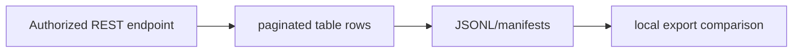

# REST Table Exporter

**Paginated PostgREST exports, progress manifests and local comparisons.**

  [](LICENSE)

[Overview](#overview) · [Quickstart](#quickstart) · [Example](#example) · [Validation](#validation) · [Documentation](#documentation)

## Overview

A Node.js toolkit for exporting exposed Supabase REST table rows and comparing local exports.

**Stack:** JavaScript ES modules · Node.js · native fetch · Supabase/PostgREST REST API · JSONL/CSV

## Choose the export boundary

| Component | Behavior |
| --- | --- |
| Offset | Offset pagination supports straightforward table traversal. |
| Keyset | Keyset pagination uses a continuation key for another traversal strategy. |
| Compare | Local comparison scripts inspect table/row differences between exports. |

## Processing path



## Quickstart

```console
node --check export-supabase-api.mjs
node --check export-supabase-keyset.mjs
node --check compare-supabase-exports.mjs
```

The commands above install prerequisites or run the specified offline checks. Live collection, cloud operations, messaging and trading are separate operational steps when present.

## Example

**Inspect the workflow**

Read the exporter environment inputs before selecting a source. Retain progress manifests with JSONL/CSV output, then compare two local exports. The quickstart only checks syntax and does not access a database. There is no bundled database dataset or provider credential.

## Configuration and storage

Use Node.js with native fetch. Source URL, authorization and export paths are script-level environment inputs. Credentials with elevated privileges require appropriate local handling and source authorization.

## Repository guide

| Location | Responsibility |
| --- | --- |
| [export-supabase-api.mjs](export-supabase-api.mjs) | Offset export |
| [export-supabase-keyset.mjs](export-supabase-keyset.mjs) | Keyset export |
| [compare-supabase-exports.mjs](compare-supabase-exports.mjs) | Export comparison |

## Validation

The quickstart lists the declared checks. No passing CI or coverage claim is implied by the technology badges.

## Scope and operational boundaries

A REST export is not pg_dump: SQL schema, policies, triggers, roles and a transactionally consistent database snapshot are outside its documented scope. No dedicated automated test suite is bundled.

## Documentation

- The repository guide above links directly to the implementation and configuration files.

## License and attribution

Project-authored source code is licensed under the [MIT License](LICENSE). Third-party components and datasets retain their respective rights and licenses.
